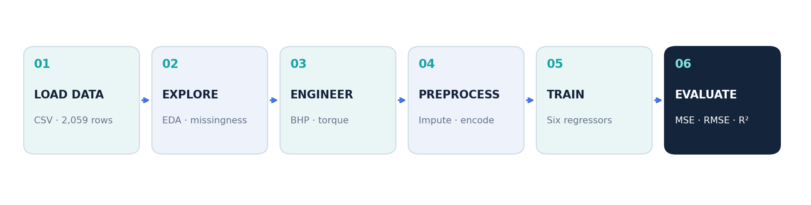
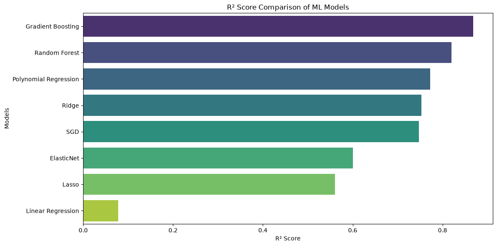
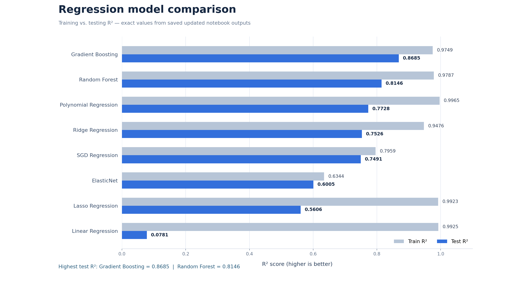
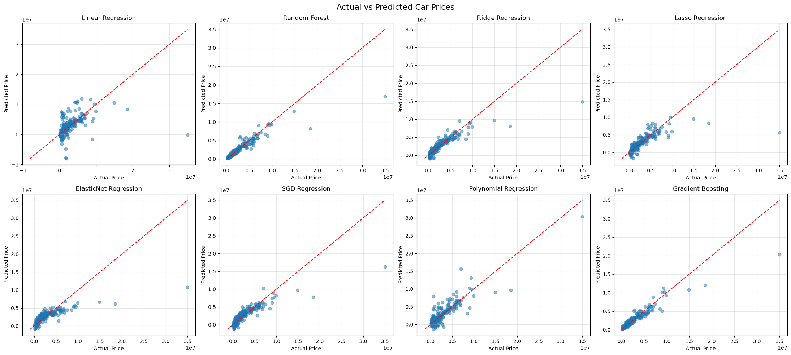
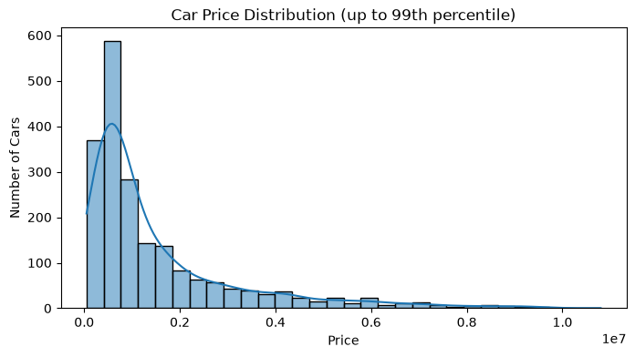
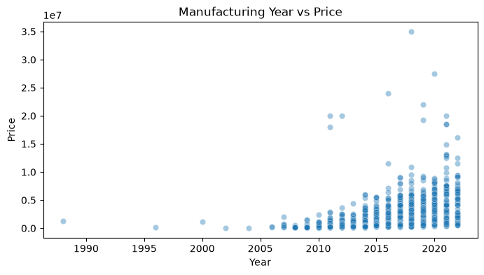
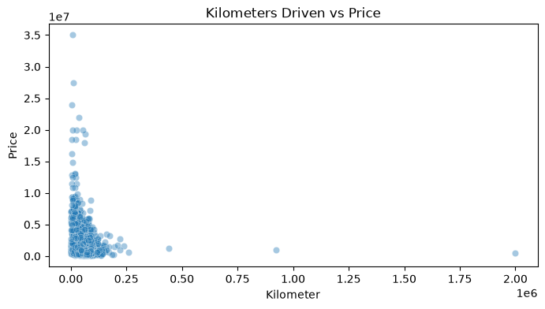
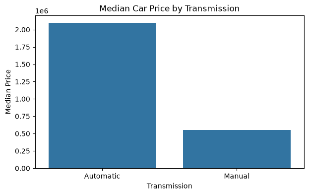
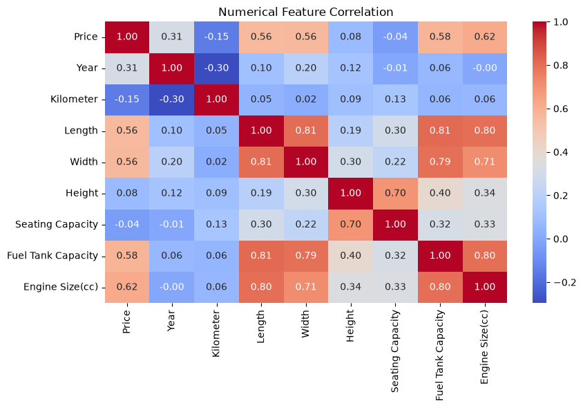

# Used Car Price Prediction Using Machine Learning

**End-to-end car price regression project with exploratory data analysis, feature engineering, reusable scikit-learn pipelines, eight regression algorithms, and model evaluation.**

`Python` · `Pandas` · `NumPy` · `Scikit-learn` · `Matplotlib` · `Seaborn` · `Jupyter Notebook`
<h2 align="center">Machine Learning Workflow</h2>

<p align="center">
  
</p>

## Overview

This project estimates the **listing price of a used car** from its specifications and listing information. It compares eight supervised regression models using the same **80% training / 20% testing** split and measures predictive performance using **R², Mean Squared Error (MSE), and Root Mean Squared Error (RMSE)**.

The main analysis is in [`Car_Price_Prediction.ipynb`](Car_Price_Prediction.ipynb), using [`car_details.csv`](car_details.csv). The metrics and figures below are **taken from the saved outputs of the provided notebook**, not from a new training run.

## Key results

| Metric | Value |
| --- | --- |
| Dataset size | **2,059 records**, **20 original columns** |
| Target | **`Price`** |
| Regression models | **8** |
| Train / test split | **80% / 20%**, `random_state=42` |
| Best model by test R² | **Gradient Boosting Regressor** |
| Best test R² | **0.8685** |
| Best test RMSE | **958,627 price units (approx.)** |

### Model performance comparison

All values below are from the notebook's saved test results, rounded for readability.

| Model | Training R² | Testing R² | Test RMSE |
| :--- | ---: | ---: | ---: |
| **Gradient Boosting** | 0.9749 | **0.8685** | **958,627** |
| Random Forest | 0.9787 | 0.8146 | 1,138,132 |
| Polynomial Regression (degree 2) | 0.9965 | 0.7728 | 1,259,753 |
| Ridge Regression | 0.9476 | 0.7526 | 1,314,622 |
| SGD Regression | 0.7959 | 0.7491 | 1,323,892 |
| ElasticNet Regression | 0.6344 | 0.6005 | 1,670,585 |
| Lasso Regression | 0.9923 | 0.5606 | 1,752,029 |
| Linear Regression | 0.9925 | 0.0781 | 2,537,855 |



**Interpretation:** Gradient Boosting achieved the best test-set R² and lowest test RMSE in this saved experiment. R² is a **regression goodness-of-fit score, not classification accuracy**. Higher test R² and lower test RMSE indicate better performance on this test split. The price currency is **not specified in the source CSV**, so errors are reported in *dataset price units*.
## R<sup>2</sup> Train & R<sup>2</sup> Test 


### Actual vs. predicted prices



Each subplot compares observed car prices (horizontal axis) against predicted prices (vertical axis). The dashed red diagonal indicates perfect predictions. Points farther from the line have larger prediction errors.

## Dataset

The input dataset contains **2,059 rows and 20 original columns**. Its target column is **`Price`**; the other 19 columns describe the listing and the vehicle.

| Category | Source columns |
| --- | --- |
| Vehicle identity | `Make`, `Model`, `Year` |
| Usage and ownership | `Kilometer`, `Owner`, `Seller Type` |
| Vehicle details | `Fuel Type`, `Transmission`, `Location`, `Color`, `Drivetrain` |
| Powertrain | `Engine`, `Max Power`, `Max Torque` |
| Physical specifications | `Length`, `Width`, `Height`, `Seating Capacity`, `Fuel Tank Capacity` |
| Prediction target | `Price` |

### Data exploration and quality checks

The notebook examines dataset dimensions, summary statistics, datatypes, missing values, numerical outlier thresholds using the **IQR method**, and negative numerical values. The CSV has **no exact duplicate rows**. Examples of missing fields include `Engine`, `Max Power`, `Max Torque`, `Drivetrain`, and some dimensions or fuel-tank specifications.

> IQR bounds and outlier visualizations are **diagnostics** in the notebook; the project does **not** automatically remove all identified outliers. The price-distribution chart excludes the top 1% of prices **for display only**, not for model training.

### Exploratory data analysis (EDA)

**Price distribution** (up to the 99th percentile, for readability):



| Manufacturing year vs. price | Kilometers driven vs. price |
| --- | --- |
|  |  |

| Median price by transmission | Correlation of numerical columns |
| --- | --- |
|  |  |

## Feature engineering and preprocessing

The workflow engineers numerical power and torque measurements from string-valued fields:

- `Max Power(BHP)`
- `Max Power(rpm)`
- `Max Torque(Nm)`
- `Max Torque(rpm)`

The original `Engine`, `Max Power`, and `Max Torque` columns are removed from the modeling feature matrix after the power/torque features are derived. An `Engine Size(cc)` column is also created in the exploratory DataFrame, **but it is not added to the final modeling feature matrix (`X`) in this notebook version**.

The project uses **`ColumnTransformer`** and **`Pipeline`** to manage preprocessing within model training:

| Feature group | Transformations |
| --- | --- |
| Numerical | Median imputation, then `StandardScaler` |
| `Owner` (ordinal) | Most-frequent imputation, then predefined `OrdinalEncoder` ordering |
| Other categorical | Most-frequent imputation, then `OneHotEncoder(handle_unknown="ignore")` |
| Polynomial model numerical inputs | Median imputation, degree-2 `PolynomialFeatures`, then scaling |

Preprocessing transformations are fitted using the training data when the model pipelines are fitted, reducing train/test leakage from imputers and scalers.

## Algorithms implemented

The notebook trains and evaluates:

1. **Linear Regression** — ordinary linear least-squares baseline.
2. **Random Forest Regressor** — ensemble of decision trees.
3. **Ridge Regression** — linear regression with L2 regularization.
4. **Lasso Regression** — linear regression with L1 regularization.
5. **ElasticNet Regression** — linear regression with combined L1/L2 regularization.
6. **SGD Regressor** — linear estimator optimized using stochastic gradient descent.
7. **Polynomial Regression** — degree-2 numerical feature expansion followed by linear regression.
8. **Gradient Boosting Regressor** — sequential tree-based boosting using `n_estimators=200`, `learning_rate=0.05`, `max_depth=3`, and `random_state=42`.

Except for the explicitly configured Gradient Boosting model and degree-2 polynomial features, the regressors use their default estimator settings in the saved notebook.

## Evaluation metrics

For actual prices \(y_i\) and predictions \(\hat{y}_i\):

- **MSE:** average squared prediction error.
- **RMSE:** square root of MSE, expressed in the same units as car prices.
- **R²:** measures fit relative to predicting the mean target value; higher is better, with 1 being perfect and negative values possible.

The notebook visualizes **Actual vs. Predicted** values for all eight regressors and provides a horizontal bar chart comparing test R² scores.

## How to run

1. Install Python and create a local project directory.
2. Download or clone the repository, retaining the `.ipynb` and `car_details.csv` files in the **same directory**.
3. Install the required libraries:

   ```bash
   pip install -r requirements.txt
   ```

   Or, if you do not have `requirements.txt`:

   ```bash
   pip install numpy pandas matplotlib seaborn scikit-learn notebook ipykernel
   ```

4. Launch Jupyter:

   ```bash
   jupyter notebook
   ```

5. Open **`Car_Price_Prediction.ipynb`** and run its cells **from top to bottom**.

The notebook reads the dataset with:

```python
df = pd.read_csv("car_details.csv")
```

The train/test split is:

```python
X_train, X_test, y_train, y_test = train_test_split(
    X, y, test_size=0.2, random_state=42
)
```

## Project structure

```text
Car-Price-Prediction/
├── Car_Price_Prediction.ipynb  # Analysis, model training, and evaluation
├── car_details.csv            # Dataset (share only if licensing permits)
├── requirements.txt           # Python dependencies
├── README.md                  # Project documentation
└── images/
    ├── price_distribution.png
    ├── year_vs_price.png
    ├── kilometer_vs_price.png
    ├── price_by_transmission.png
    ├── numeric_correlation_heatmap.png
    ├── actual_vs_predicted_models.png
    └── r2_comparison.png
```

## Findings and limitations

- **Gradient Boosting is the best performer** among the eight evaluated models on this saved test split, with a test R² of approximately **0.8685**.
- **Random Forest is second**, with test R² of approximately **0.8146**.
- Several linear models show a gap between train and test performance, which can indicate overfitting or sensitivity to dataset composition.
- The saved run is based on **one 80/20 split**, not cross-validation. Results are not guaranteed to hold for other splits or new data.
- Random Forest and SGD are not given explicit `random_state` values in the notebook, so rerunning may change their scores.
- `Engine Size(cc)` is created only in the exploratory DataFrame; add it explicitly to `X` if you want it to become a predictive feature.
- The code does not save a serialized trained estimator or provide a deployment interface.

### Possible next steps

- Use cross-validation or a separate validation set for model selection and hyperparameter tuning.
- Examine residual plots and segment-specific errors, including expensive cars.
- Consider price-target transformation and regularization to address skew and overfitting.
- Add a consistent random seed to every stochastic model for reproducibility.
- Save the best validated pipeline using a safe, controlled model persistence workflow.

## Data source and attribution

This project uses the locally supplied `car_details.csv` dataset. The original source, license, and price currency were **not documented in the provided files**. Add the dataset's original source and license before publishing it publicly, and do not upload private or restricted data.
